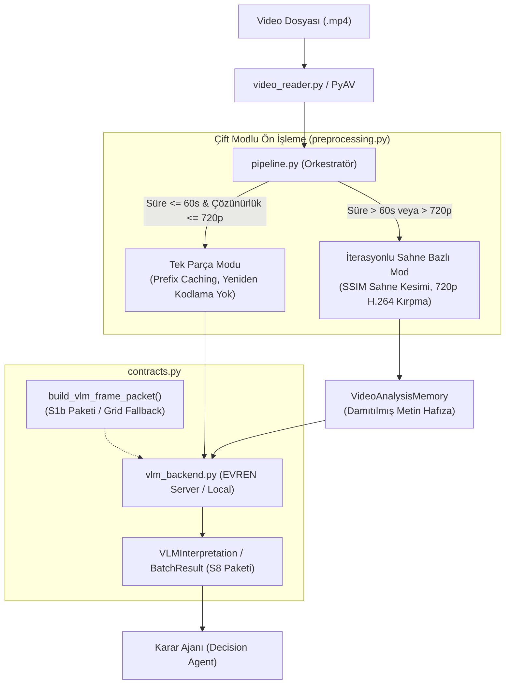

# Kanal B — Görsel Dil Modeli (VLM) Sahne & İSG Analiz Katmanı

Bu paket, **TEKNOFEST Yapay Zeka Yarışması** kapsamında geliştirilen ve güvenlik kameralarından alınan video kayıtlarını Görsel Dil Modelleri (Vision-Language Models / Multimodal LLM) ile semantik olarak yorumlayan **Kanal B** alt sistemidir.

---

## 📌 Genel Bakış ve Mimari Rolü

Kanal B, nesne tespit ve takip modelleri (YOLO / ByteTrack) ile kural motorundan oluşan **Kanal A**'dan tamamen bağımsız çalışır. Temel amacı:
- Sahneyi insan gözü gibi bütüncül olarak yorumlamak,
- İş Sağlığı ve Güvenliği (İSG) risklerini, kural motorunun yakalayamayabileceği karmaşık görsel bağlamları değerlendirerek tespit etmek,
- Karar Ajanı'na (**Decision Agent**) yapılandırılmış ve bağımsız olarak puanlanmış **S8 Sözleşmesi** formatında veri sunmaktır.



---

## 🚀 Temel Yetenekler ve Özellikler

### 1. Çift Modlu Çıkarım Mimarisi
* **Tek Parça Modu (Single-Shot):** Süresi 60 saniyeyi ve çözünürlüğü 720p'yi aşmayan videolar üzerinde yeniden kodlama (transcoding) yapılmaz. Orijinal baytlar korunduğu için TEKNOFEST EVREN VLM sunucusunun **Ön Ek Önbelleği (Prefix Cache)** tam verimle çalışır.
* **İterasyonlu Sahne Bazlı Mod (Iterative Scene-Based):** 60 saniyeden uzun videolar, Yapısal Benzerlik (SSIM) analizine dayalı `detect_scene_boundaries()` fonksiyonu ile doğal sahne geçişlerinden kesilir. GPU (`h264_nvenc`) veya CPU (`libx264`) donanım hızlandırmasıyla 720p formatında optimize edilir.

### 2. Metin Tabanlı Dinamik Hafıza (`VideoAnalysisMemory`)
Uzun videolarda önceki segmentlerin ham çıktılarını veya token dizilerini biriktirmek bağlam penceresini (context window) şişirir. `VideoAnalysisMemory` yapısı:
- Önceki kliplerden yalnızca **anlamsal notları** (görülen araçlar, ortam nitelikleri) ve **zamansal olayları** (zaman damgalı riskler) damıtır,
- Belirlenen limitlerde en eski kayıtları budayarak (`_trim()`) token maliyetini sabit bir tavanda tutar.

### 3. Çok Kademeli Güvenli Ayrıştırma ve Güven Skoru
- **Reasoning Trace Ayrıştırma:** Qwen2.5-VL gibi modellerin `<think>...</think>` düşünce izi blokları ayıklanıp `reasoning_trace` alanına aktarılır; JSON bloğu bozulmadan ayrıştırılır.
- **3 Kademeli JSON Çözücü:** Standart `json.loads`, Markdown kod bloğu regex'i ve greedy süslü parantez aramasıyla hatalı biçimlendirilmiş yanıtlar tolere edilir.
- **Kalibre Edilmiş Güven Skoru (`_compute_confidence`):** Modelin kendi beyanına ek olarak; parse başarısı, risk şiddeti ağırlıklandırması ve destekleyici kare sayısı hesaba katılarak dışsal bir güven skoru üretilir.

---

## 📂 Dizin ve Modül Yapısı

| Dosya | Görev ve Sorumluluk |
|---|---|
| `pipeline.py` | Kanal B'nin ana yürütücüsüdür (`run_channel_b`, `run_channel_b_scene_based`). Mod seçimini, hafıza yönetimini ve S8 üretimini orkestre eder. |
| `contracts.py` | S1b (`VLMFramePacket`), S8 (`VLMInterpretation`), `RiskEvent`, `DetectedEntity`, `SegmentResult`, `BatchResult` ve `VideoAnalysisMemory` veri sınıflarını tanımlar. |
| `preprocessing.py` | Video çözünürlük inceleme (`probe_video`), SSIM sahne tespiti, 720p H.264 video kesimi ve yerel modeller için 2x4 grid montajını yürütür. |
| `vlm_backend.py` | TEKNOFEST EVREN API (`ServerBackend`), vLLM (`VLLMBackend`), llama.cpp (`LlamaCppBackend`) ve HuggingFace (`TransformersBackend`) adaptörlerini içerir. |
| `video_reader.py` | PyAV (FFmpeg) tabanlı, PTS zaman damgası korumalı ve bellek dostu video okuma jeneratörü (`read_video_stream`, `VideoReader`). |
| `__init__.py` | Kanal B paketinin standart dışa aktarımlarını (exports) ve paket seviyesi arayüzünü tanımlar. |

---

## 🛠️ Konfigürasyon (`config.yaml`)

Kanal B ayarları proje kökündeki `config.yaml` dosyasından okunur:

```yaml
vlm:
  default_backend: "server"  # 'server' | 'vllm' | 'llama.cpp' | 'transformers'
  server:
    base_url: "https://evren-llmapi.ssyz.org.tr/v1"
    model_name: "llm-large"  # Görsel/Grid modeli
    video_model: "vlm"        # Doğrudan video modeli
    api_key_env: "EVREN_API_KEY"
    temperature: 0.15
    max_tokens: 65536
    timeout_sec: 1800
    enable_thinking: false

preprocessing:
  target_frame_count: 8
  min_laplacian_variance: 40.0
  scene_ssim_threshold: 0.30
  scene_min_segment_sec: 15.0
  scene_max_segment_sec: 60.0
  vlm_max_height: 720
  vlm_clip_crf: 23
```

---

## 💻 Kullanım Örnekleri

### Temel Çalıştırma (Karar Ajanı Entegrasyonu)

```python
from Kanal_B import run_channel_b

# Videoyu analiz et (Kısa veya uzun video otomatik yönetilir)
s8_sonucu = run_channel_b(
    video_path="ornek_video.mp4",
    video_id="video_001",
    output_dir="./out/channel_b"
)

print("Sahne Özeti:", s8_sonucu["scene_summary_tr"])
print("Tespit Edilen Riskler:")
for risk in s8_sonucu["risk_events"]:
    print(f"- [{risk['severity']}] {risk['description_tr']} (Güven: {risk['confidence']:.2f})")
```

### Segment Bazlı Ayrıntılı Analiz (Zaman Çizelgesi ve Raporlama)

```python
from Kanal_B import run_channel_b_scene_based

batch_sonucu = run_channel_b_scene_based(
    video_path="uzun_fabrika_kaydi.mp4",
    video_id="fabrika_01"
)

print(f"Toplam İşlenen Segment: {batch_sonucu.total_segments}")
if batch_sonucu.most_critical_segment:
    print(f"En Kritik Segment İndeksi: {batch_sonucu.most_critical_segment.segment_index}")
```
